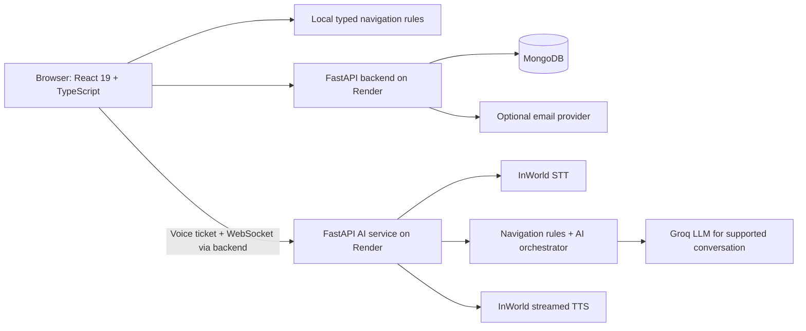

# MantraSetu — Saarthi

A React and FastAPI project for discovering puja services, registering pandits, and navigating the website through Hindi, Hinglish and English conversation.

**Live website:** https://saarthi-mantrasetu.vercel.app/

[](https://github.com/yash2595/Saarthi/actions/workflows/ci.yml)

## What works and what needs configuration

| Area | Implementation and verification |
| --- | --- |
| Voice conversation | WebSocket transport, microphone capture, STT adapters, navigation orchestrator and streamed TTS. Automated contracts use mocked providers; separate real InWorld STT/TTS and Groq checks also pass. A synthetic Hindi command also passes through the deployed backend/STT/navigation/TTS pipeline. Browser microphone permission is required for a conversation on the user’s device. |
| Authentication | Bcrypt password hashing, signed access tokens, signup/login, profile identity and expiring email verification. Verified against disposable local MongoDB; the deployed database is connected. |
| Pandit onboarding | Multipart registration, draft resume capabilities expiring after seven days, private documents, admin review and approved-only public directory. Verified locally; production MongoDB is connected. Real document storage still requires a durable storage setup. |
| Booking | Validated request creation and owner-scoped history. A request is **not a confirmed pandit assignment**. No payment, availability or fulfillment integration is implemented. |
| Kundali | Birth-detail capture/storage and frontend validation. A real astronomical chart calculation is **not implemented**. |
| Muhurat | Sample timings are explicitly labelled; this is **not an astronomical calculation service**. |
| Email | Optional HTTPS Resend delivery or bounded SMTP fallback. Missing configuration returns delivery failure rather than claiming an email was sent. Real delivery requires a provider and verified sender. |

The backend and AI services now have matching database/voice configuration and real provider keys. AI `/health` verifies MongoDB and orchestrator readiness. Missing configuration still returns `503 configuration_required`; process health and dependency readiness remain separate. The current live catalog is empty, so frontend preview cards do not establish real availability.

## Architecture



Both server applications use Python/FastAPI; there is no Node/Express backend. The frontend uses React Router and Vite. Voice page commands use deterministic navigation rules and remain separate from LLM output. There is no separate typed chat interface. The frontend validates incoming route targets before routing and never treats navigation as permission to submit a form.

## Repository layout

- `final frontend mantrasetu/MantraSetu-Saarthi-main` — React frontend.
- `final backend mantrasetu/mantrasetu-saarthi-backend-main` — authentication, catalog, registration, uploads, booking and voice proxy.
- `FINAL ai Mantra setu/MantraSetu-Saarthi-feature-ai-intent-engine` — voice transport, STT/TTS, orchestration and navigation framework.
- `deployment` — startup checks, repeatable AI test runner and hosting notes.

## Local setup

Use Python 3.12, Node 22 and MongoDB. Create a Python virtual environment and install each server's requirements. AI runtime dependencies include sentence-transformers/Chroma; its production build uses CPU PyTorch.

Create untracked `.env` files in each application folder. Generate random values for signing/admin secrets; do not use example strings as production secrets.

Backend variables:

```dotenv
MONGODB_URI=mongodb://127.0.0.1:27017
DATABASE_NAME=mantrasetu
JWT_SECRET_KEY=<generate-a-long-random-secret>
ADMIN_SECRET_KEY=<generate-a-different-long-random-secret>
VOICE_TICKET_SECRET=<shared-random-voice-secret>
CORS_ORIGINS=http://localhost:5173
AI_SERVICE_URL=http://localhost:8002/api/v1
BASE_URL=http://localhost:8000
FRONTEND_URL=http://localhost:5173
# Optional email: RESEND_API_KEY and EMAIL_FROM (verified sender)
```

AI variables:

```dotenv
MONGODB_URI=mongodb://127.0.0.1:27017
DATABASE_NAME=mantrasetu
VOICE_TICKET_SECRET=<same-voice-secret-as-backend>
GROQ_API_KEY=<real-provider-key>
INWORLD_API_KEY=<real-provider-key>
LLM_PROVIDER=groq
GROQ_LLM_MODEL=openai/gpt-oss-20b
PREWARM_TTS_CACHE=false
CORS_ORIGINS=http://localhost:5173
API_BASE_URL=http://localhost:8000
MAIN_BACKEND_URL=http://localhost:8000
```

Frontend variable: `VITE_API_BASE_URL=http://localhost:8000`. Vite variables are public browser configuration: never place provider/database/admin secrets in them.

From the respective application directories, run:

```sh
# Backend
python -m pip install -r app/requirements.txt
python -m uvicorn app.main:app --host 127.0.0.1 --port 8000
# AI (separate terminal/environment)
python -m pip install -r requirements.txt
python -m uvicorn app.main:app --host 127.0.0.1 --port 8002
# Frontend
npm ci
npm run dev
```

## Repeatable verification

From the repository root:

```sh
python -m pip install -r "final backend mantrasetu/mantrasetu-saarthi-backend-main/app/requirements.txt" -r deployment/requirements-test.txt
python deployment/run_ai_checks.py
python -m pytest deployment/test_startup.py -q
```

From the backend directory, with a local test MongoDB running:

```sh
python -m pytest tests/test_security_contract.py -q
```

The backend suite always uses a generated database named `saarthi_contract_<random>`, generated signing keys, synthetic files and mocked email delivery, then removes its database/files. `TEST_MONGODB_URI` can select a disposable MongoDB server; never point test infrastructure at production.

From the frontend directory:

```sh
npm test
npm run lint
npm run build
npm audit --audit-level=moderate
```

CI runs these scoped contract suites in separate application processes because both Python applications have a top-level `app` package. Historical root-level `test_*.py` files include exploratory scripts that require a running local server or real provider keys; they are not the CI acceptance suite. They should not be mistaken for automated proof of production voice quality.

The AI suite exercises real WebSocket JSON framing, role-aware greetings, navigation round trips, malformed-frame recovery, ticket/origin rejection, synthetic PCM framing, mocked provider contracts, session/error handling and navigation framework behavior. It does not measure real STT accuracy, provider latency or microphone quality.

## Deployment and limits

See [deployment/README.md](deployment/README.md). Vercel hosts the frontend; Render hosts the two server applications. Backend `/health` and AI `/live` test process availability. Backend `/ready` and AI `/health` test readiness.

Free Render instances can sleep and lose uploaded local files on restart/redeploy. Durable document storage is required before accepting real identity documents. The deployed services share an Atlas database name and voice ticket secret. Groq uses an available `openai/gpt-oss-20b` model with a reasoning-aware output budget. TTS cache pre-generation is optional to avoid generating every prompt on each restart. Complete browser microphone, email-sender and account-flow acceptance before a production demonstration.

Demo auth/booking/calculation stubs in the AI service are disabled by default and cannot be enabled on Render. The production backend remains the authoritative account/booking service.

For a resume, describe the implemented architecture and tested behavior. Do not claim production voice accuracy, real astrology calculations, payments, confirmed fulfillment or measured load capacity without completing those integrations and measuring them.
